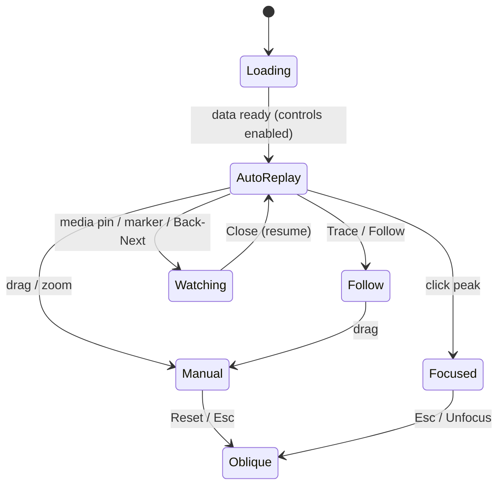

# DESIGN.md: visual and interaction design reference

Reference: the **Hakkoda replay** demo (https://demo.pa-to-po.com/demos/hakkoda-replay/), studied 2026-10-14/15 from its live HTML/CSS/JS and screenshots (desktop 1440 px, mobile 390×844).
Purpose: a design vocabulary for **mount-replay** (the Mount Kinabalu climb replay).

> **Ideas only.** The demo has no licence. Nothing here is copied code. Tokens and patterns are described in our own words. Short lists of values (colours, sizes, spacing) are kept as measurements. Build everything in mount-replay from scratch.

---

## 1. Overview and design principles

The demo replays a 4-hour, 12 km hike over a 3D terrain made of points of light. It feels like an **expedition instrument panel at night**: near-black, thin hairlines, monospace readouts, and one warm orange accent for "you are here / what's active".

Principles:
1. **The map is the stage.** The terrain fills the viewport, and every other element floats over it as a light overlay or sits in a docked strip.
2. **One accent colour, used sparingly.** Orange marks only the live state: the travelled route, the current position, the pressed toggle, the primary button, and the hover state.
3. **Instrument typography.** UPPERCASE monospace labels with wide letter-spacing, numbered sections ("01 / … 03 / ELEVATION"), and tabular figures.
4. **Hairlines instead of fills.** Panels are 1 px outlines on the background, with no cards, no shadows, and radii of 0–3 px.
5. **Quiet decoration with meaning.** Scanlines, an altitude ruler, a faint coordinate log and an angled "expedition plate" add atmosphere. Each is muted, uses `aria-hidden`, and ignores the pointer.
6. **Time is the main axis.** Map, chart, clock, media and labels all follow a single playback clock.
7. **Explain the data honestly.** A collapsible "about the record" note gives sources, the vertical exaggeration and how values were estimated.

## 2. Layout grid

### Desktop (≥ 761 px)
- **Header:** 48 px high (earlier versions used 72–90 px), with 22 px side padding. The body does not scroll (`overflow:hidden`). The dashboard is `100dvh − 48px`, with 10 px side padding and 6 px bottom padding.
- **Terrain panel:** fills the whole dashboard. The live-data and record sidebar is not a permanent column in the final version. It moved into a **modal dialog** (opened from the header) to give the map more room.
- **Bottom dock:** floats inside the terrain panel, inset 4.5 % from the left, 3 % from the right and 12 px from the bottom. Its height is a token, `--dock = clamp(200px, 23dvh + 50px, 250px)`. It is a two-column grid: ELEVATION (fluid) | LOCATION inset (270 px), with a 22 px gap, a semi-opaque background and a 1 px top line.
- The 3D canvas height is `100% − dock − 25px`, so the terrain never draws under the dock. Every bottom-anchored overlay (labels, legend, ruler, status) is placed relative to `--dock`.
- **Gallery drawer:** fixed to the right edge, 340 px wide, below the header. While it is open, the dashboard reserves the space with a right margin. A vertical pull tab sits at 43 % of the viewport height on the right edge.
- **Film player:** while a film plays (`watching`), the terrain shrinks to column 1 and the player takes a right-hand column (the earlier sidebar slot).

```
┌──────────────────────────────────────────────────────────────────────┐
│ ⛰ HAKKODA  八甲田山        [Films 53] [Record] 2026.10.05  DEMO LAB ↗ │ 48px
├──────────────────────────────────────────────────────────────────────┤
│ 01 TITLE ────────────────── [Auto][Follow][Oblique][Top][Reset]      │
│ AZ −30°/EL 26° [Colour][Mono]                     summit focus hint  │
│ ┤1800                                                                │
│ ┤1500        · · ·  dot terrain  · · ·        ◯ PEAK 1,584 m         │
│ ┤1200     ╱ contours ╲      ▶ media pin                  coord log   │
│ ┤ 900   ◯ START                                                      │
│ ▶ 600      ▱ EXPEDITION PLATE ▱             ● AUTO REPLAY  scan 755m │
│ drag to rotate · scroll to zoom        ── route ━━ travelled ● now   │
│ ┌─ dock ───────────────────────────────────────┬───────────────────┐ │
│ │03 / ELEVATION · ▶ FILMS          progress lbl│  world → region   │ │
│ │[← Back][Next →][◎ Trace]          step status│     inset map     │ │
│ │  ▶  ▶3   ╱‾‾‾╲___╱‾‾‾‾╲    profile chart     │      ✶           │ │
│ │ 09:00     10:00      11:00     12:00   13:00 │ 40.659°N/140.877°E│ │
│ │[▶ Play] ━━━━━━━●──────────── [600×▾] [↻Loop] │                   │ │
│ └──────────────────────────────────────────────┴───────────────────┘ │
└──────────────────────────────────────────────────────────────────────┘
```

### Breakpoints
| Name | Range | Changes |
|---|---|---|
| wide | ≥ 1600 px | the old sidebar grows to 330–365 px, with larger clock figures |
| desktop | 1101–1599 | baseline |
| tablet | 761–1100 | view buttons get smaller (11 px), toolbar wraps, time labels in the playback row are hidden, inset narrows to 210 px. When the gallery or a film is open, the inset leaves the dock and floats above it at 145–170 px |
| short | ≥ 761 and height ≤ 850 | tighter vertical padding, 72 px header in older versions |
| very short | height ≤ 600 | expedition plate hidden, toolbar nudged up |
| mobile | ≤ 760 | see §15 |

### Mobile (≤ 760 px)
- 48 px header: title only (the logo, Japanese subtitle and date are dropped). Nav buttons are 9–10 px.
- The terrain fills the screen. The dock becomes a single column (12 px insets, `--dock = clamp(220px, 26dvh + 50px, 265px)`).
- The LOCATION inset leaves the dock and floats in the **top right** of the map (130 px wide, 82 px canvas, with border and background). The coordinates line is hidden.
- The film player becomes an overlay card below the toolbar with a heavy drop shadow. The gallery drawer is `min(330px, 100vw − 40px)` and overlays the map instead of pushing it.

```
┌─────────────────────────┐
│ HAKKODA   [Films][Rec]↗ │
│ 01 TITLE                │
│ [Auto][Fol][Obl][Top][R]│ ┌inset┐
│ AZ/EL [Col][Mono]       │ └─────┘
│┤  · · dot terrain · ·   │
│┤    ◯ PEAK              │
│▶   ◯ START              │
│ focus hint     [unfocus]│
│ legend    ● AUTO  scan  │
│┌ dock ─────────────────┐│
││03/ELEV        progress││
││[←][→][◎]  step status ││
││ profile ▶ ▶2          ││
││[▶] ━━━●──── [600×][↻] ││
│└───────────────────────┘│
└─────────────────────────┘
```

## 3. Colour tokens

Core (final cascade; the first draft values are in brackets):
| Token | Hex | Use |
|---|---|---|
| `bg` | `#070809` (`#0b1012`) | page, 3D clear colour, theme-color |
| `surface-dock` | `#080c0d` at ~91 % alpha (`e8`) | bottom dock, floating inset |
| `surface-dialog` | `#090c0e` at ~96 % alpha | dialogs; backdrop `#000` at ~73 % with a 4 px blur |
| `surface-drawer` | `#0a0d0f` at ~96 % alpha | gallery drawer |
| `surface-chip` | `#0b1012` at ~93 % alpha | chart markers and place labels |
| `surface-raised` | `#111719` / `#141b1e` | close buttons, picker rows |
| `text` | `#eef0ee` | primary |
| `text-2` | `#ccd3d5` / `#b9babb` | secondary, map labels |
| `text-muted` | `#a0abae` | notes, dt labels |
| `text-dim` | `#777` – `#888` | toolbar captions, label sub-lines, paused status |
| `text-ghost` | `#ffffff` at ~14 % | decorative coordinate log |
| `line` | `#44484a` (`#344247`) | panel borders, dividers |
| `line-strong` | `#505254` / `#59615c` | terrain panel border, dialog border |
| `accent` | `#f59b4c` (`#ff9254`) | primary button, pressed state, hover, focus ring |
| `accent-hover` | `#ffad7d` | primary button hover |
| `accent-soft` | `#ffb166` – `#ffbd85` | current-position label, status text |
| `accent-tint` | accent at ~6 % alpha | background of a pressed toggle |
| `route-travelled` | `#f58a24` / `#ff951f` | travelled track (thick) and glow |
| `route-remaining` | `#cfbca0` (pale beige) | full route (thin) |
| `current-dot` | `#fff9ec` with a `#ff951f` glow | the walker |
| `on-accent` | `#101010` – `#111618` | text on orange |

Map and chart:
| Token | Hex | Use |
|---|---|---|
| dot ramp low → mid → high | warm-dark `#1a100b`/`#211a12` → teal-grey `#adc8c6`/`#a4c5cf` → near-white `#eaf3f5` | colour mode: points shaded by height (smoothstep over 5–60 % and 60–95 % of the range) |
| mono ramp | greys `#ccd3d3`/`#c9d0cf` | mono mode |
| scan band | `#ffb653`/`#ffb773` | moving light band |
| ground grid | `#29393e` major / `#1e2b2f` minor | 9 km helper grid below the terrain |
| contour | soft teal-grey, low alpha; every 100 m brighter | 25 m contour interval |
| chart grid | `#223035` / `#29363c` | horizontal elevation lines and time ticks |
| chart axis text | `#a6b4b9` / `#b0bdc1` | |
| chart area fill | accent at 30 % → 1 % vertical gradient | under the profile |
| chart cursor dot | `#fff0dc` | |
| media marker | border `#b5a18b`, text `#e4c6a6`; active fill accent with `#ffe0bd` border | |
| inset land / coast | `#24363b` / `#344b50`, text `#96b7b9`/`#a8bdbd`, location marker `#ff9254`/`#ffab65`, frame `#b4794e` | |

## 4. Typography

- **Monospace everywhere** in the final version: `Consolas, SFMono-Regular, monospace`, with a Japanese UI sans as fallback. The first draft paired a humanist sans for body text with mono for numbers. We suggest **mono for labels and numbers, a system sans for prose and CJK**.
- Base size 14 px. Most UI text is 9–12 px.

| Role | Size / weight / tracking | Case |
|---|---|---|
| Brand title | 18 px, regular, 5 px tracking (draft: 36 px bold, 4 px) | UPPERCASE |
| Header nav | 10–11 px mono, 1–1.5 px tracking | |
| Section heading "0N / NAME" | 10–13 px mono, regular, 1.6–3 px tracking, `#a6a8aa` | UPPERCASE |
| Toolbar buttons | 10 px mono | |
| Map label (peak) | 12 px mono, 1 px tracking; sub-line 10 px `#777` | name + height |
| Checkpoint label | 10 px `#999` (hidden on mobile) | |
| Current-position label | 10–11 px mono, 1 px tracking, orange | |
| Legend / hints | 10 px mono, 2 px tracking, `#707476` | |
| Chart axis | 10 px mono | |
| Clock (record dialog) | 33–54 px mono bold, −1 px tracking | |
| Metric value | 22–31 px mono bold, −1 px; unit 13–19 px | |
| Expedition plate | 20 px mono, 4 px tracking; sub-line 8 px | UPPERCASE |
| Primary button | 14 px bold (desktop), 10–12 px (mobile) | |

Rules: tabular numerals for every time and number; no italics; bold only for the main numbers.

## 5. Spacing, radius, border

- Spacing scale used in practice: **4, 5–6, 7–8, 9–10, 12, 14–16, 18, 22, 28 px**. Gaps between panels 10–12 px. Overlay inset from the panel edge ~4.5 % horizontally and 14–18 px vertically.
- **Radius:** 0 in the final version (toolbar, labels, cards), 2 px for base buttons, 3 px for the gallery tab, 10 px for the pill-shaped chart media markers, 50 % for map media pins and dots.
- **Border:** always 1 px solid. Panel border `line`. Toggles `#434648` → pressed `#aaa`. No drop shadows, except overlays that float above the map (picker, mobile film card, drawer, at ~35 px blur, black at 40–80 %).
- **Hit targets:** default min-height 34 px; compact controls 26–28 px; map peak buttons min 44×110 px; media pins 30–32 px.

## 6. Components

### 6.1 Header
Line-drawn monoline mountain logo (stroke only) · title · Japanese subtitle · on the right: `Films 53` (opens the gallery drawer), `Record · Summits` (opens the dialog), date, external link in accent with a hairline divider. The buttons are outline buttons that open dialogs (`aria-haspopup`, `aria-expanded`).

### 6.2 Chapter / sidebar panel (record dialog)
Sections are numbered like chapters: **01** terrain title, **02 / LIVE DATA** (big clock, then a three-up of altitude, distance and elapsed time), **05 / waypoints**, record totals (distance, duration, max altitude, total ascent) as a two-column definition list with hairlines on top, then a `<details>` with data notes. Waypoint buttons are full-width, left-aligned and three lines: a mono kicker "START / …" or "SUMMIT / …", a 15 px name with a mono height, and a mono hint "… ↗". The first one (START) is in accent. On desktop the dialog lays waypoints out in two columns.

### 6.3 Map toolbar and overlays
- **Top bar:** title (left), view toggles (right) at 65 % opacity until used. Below it, the camera readout "AZ −30° / EL 26°" and a Colour/Mono segmented pair.
- **Altitude ruler:** a left vertical hairline with ticks (every 50 m as a fine background tick, labels every 300 m) and a ▶ cursor that follows the **scan band**, not the walker.
- **Scan readout:** "scan altitude 755 m", muted mono, bottom right.
- **Replay status:** a 5 px glowing orange dot and "AUTO REPLAY". When paused, both turn grey with no glow.
- **Coordinate log:** a ghost-white column of recent coordinates on the right, with the current line in accent.
- **Expedition plate:** a framed name, date and distance, rotated 7° and skewed 12°. Decorative.
- **Legend (bottom):** thin beige line = full route, thick orange = travelled, dot with glow = current position. Paired with the hint "drag to rotate · scroll to zoom".
- **Scanlines:** a repeating 4 px horizontal stripe over the whole terrain at ~70 % opacity.
- **Focus control:** "click a summit name to focus" status plus an `Unfocus` button that appears only while focused.

### 6.4 Map labels
- **Peak label:** a button anchored at the bottom left. A 9 px hollow ring marks the exact point, the text sits above and to the right, and a thin SVG leader line connects the label to the peak when it has to be moved to avoid overlap. Translucent background. Hover/pressed: accent text, a darker warm background and a 2 px accent bar inside the left edge. Pressing it flies the camera to that summit.
- **START** label is styled like a peak (accent outline in the draft version).
- **Checkpoint label:** smaller and grey, hidden on mobile.
- **Runner label:** a mono time and altitude chip under the current dot, in orange.
- Labels hide when they fall outside the frustum, sit too close to the edge (|x| > 0.94, |y| > 0.85 in NDC), or the camera is too far away.

### 6.5 World / region inset (LOCATION)
A canvas with two linked maps: a small world view, then a zoom into the region (Japan → northern Honshu), with a frame showing the zoom area and an orange marker at the highest point of the record. A small mono coordinate line sits below. A slow pulse runs only while playing and is off when the user prefers reduced motion. An error message is used if the data fails to load.

### 6.6 ELEVATION dock
Order from top to bottom:
1. **Heading row:** "03 / ELEVATION · ▶ FILMS" on the left. On the right, an accent **progress label** (the nearest place name, "start point", "end of record").
2. **Route navigation:** `← Back` · `Next →` · `◎ Trace` (10 px mono, 28 px tall), and on the right a short status line (e.g. "media 3 / 53"). Back/Next step through the capture points in time order and move the clock there. Trace is a toggle (`aria-pressed`) that turns on the follow camera. All three are disabled until the data has loaded.
3. **Profile chart** (canvas, crosshair cursor): elevation against time. Horizontal elevation gridlines with labels on the left. 3 time ticks when narrower than 500 px, otherwise 5, with the first one left-aligned, the last right-aligned and the rest centred. The whole profile is a thin line, the travelled part an orange line with a fading orange area beneath, and the current position a cream dot. Click or drag to seek; vertical scrolling still passes through on touch.
   - **Media markers:** small pill chips "▶" sitting on the curve at the capture time.
   - **Cluster markers:** markers closer than ~28 px merge into one "▶N" chip at their average position. Clicking it opens a **picker** popover above (up to 280×230 px) with a heading "time — N clips" and rows of thumbnail + time. Esc closes it.
   - **Place chips:** 17 px flat labels on the axis for named places. Hover or focus turns them accent on a warm-dark background. Their tooltip shows the name, time and source.
4. **Playback row** (1 px top line, ≥ 48 px tall): **Play** primary (solid accent, dark text, 90–114 px wide, 40 px tall, icon + word; the label reads Play / Pause / Again) · elapsed time (hidden in the dock) · **slider** (flexible width, accent-coloured, 28 px hit area) · total time (hidden in the dock) · **speed select** 30/60/120/240/**600**/1200/2400 × · **↻ Loop** toggle (on by default).

### 6.7 Media pins (on the map)
30 px round chips with a dark fill, a bronze border and a small mono glyph at the projected capture point. Hover or pressed fills them with accent and dark text. Clicking opens the film player.

### 6.8 States (all controls)
| State | Treatment |
|---|---|
| default | 1 px `line` border, transparent background, `text` colour |
| hover | border becomes accent (primary: lighter orange fill) |
| pressed / active (`aria-pressed=true`) | accent text and border, ~6 % accent tint; mono toolbar toggles use light grey instead of orange |
| focus-visible | 2 px accent outline, offset 4 px (1 px / 3 px on map labels) |
| disabled | 50 % opacity, `wait` cursor (they are disabled only while loading) |
| hidden | removed from layout, not dimmed |

## 7. 3D map style
- **Dot terrain:** the DEM is drawn as a point cloud, not a mesh. Point size shrinks with distance (clamped to 1–4 px × DPR), with a slow random size drift and a twinkle. Brightness = height ramp + hillshade³ + height⁴ highlight. A second, faint additive pass (about 14 % intensity) adds a bloom.
- **Vertical exaggeration** ×2.4 above a base height. This is stated in the data note.
- **Clipped footprint:** only the connected area above a floor height that contains the route is drawn, so the mountain floats as an island. Its boundary is drawn as a contour.
- **Contours:** every 25 m, with every 100 m brighter, built from the height grid (marching squares) as line segments.
- **Scan band:** a band of light that climbs from the lowest to the highest point every **20 s of real time**, brightening the dots and contours it passes. It runs independently of playback and stops when the user prefers reduced motion.
- **Ground grid** far below, in very dark teal.
- **Route:** a full-route line in pale beige plus a thicker travelled line in orange, draped on the surface. The current dot glows.
- **Colour / Mono** switch for the dot palette.
- **Camera modes** (one is pressed at a time):
  - **Auto** (default): a slow scripted orbit around the area.
  - **Follow / Trace:** a fixed offset behind and above the walker that keeps the current azimuth. It eases toward the walker each frame (exponential, rate ≈ 6/s; snaps when reduced motion is on). Any drag cancels it ("drag to stop following").
  - **Oblique:** a 3/4 view fitted to the bounds (≈ −30° azimuth, 26° elevation).
  - **Top:** straight down.
  - **Reset:** back to Oblique.
  - **Summit focus:** clicking a peak flies to it. Esc or Unfocus returns to Oblique.
  - **Manual:** any orbit gesture drops automatic modes. Orbit controls with damping 0.08 and a min/max zoom distance.
- The readout shows the live AZ/EL. A compass was present in the draft and later hidden.

## 8. Motion and timing
- **Playback clock:** `seconds += real Δt × speed`. Speeds 30–2400×, default **600×**, which plays the 4 h track in ~24 s. Loop wraps around. Without Loop it stops at the end, and pressing Play again restarts. The clock pauses while the tab is hidden.
- **Camera transitions:** 1.3 s with smoothstep easing (ease-in-out cubic), interpolating both position and target. Instant when reduced motion is on.
- **Follow:** exponential smoothing, no fixed duration.
- **Ambient:** the 20 s scan loop, twinkle, the inset pulse while playing, and the replay-status glow. All of these are decorative and stop when reduced motion is on.
- **UI:** no CSS transitions on controls. State changes are instant, which suits the instrument feel.

## 9. Media viewer
- **Film player panel** (desktop: right column; mobile: floating card). Heading "FIELD FILM" and `Close ×`, `← Back`/`Next →` between clips, a 16:9 video with native controls (`playsinline`, no preload), an accent metadata line (time and length) and a status line. A note explains that **position and altitude sync to the video time**: while a video plays, the replay clock is set to start + currentTime, so the map and chart follow the footage. Closing it resumes the replay.
- **Gallery drawer:** a right drawer with two thumbnail columns (16:9, desaturated to 65 %, full colour on hover or when selected), an accent index number and the time. Opened from the header button or the vertical edge tab. Esc closes it.
- Entry points: a map pin, a chart marker or cluster picker, a gallery card, or Back/Next.

## 10. Interaction and keyboard
- Drag to orbit, scroll or pinch to zoom; dragging always takes over from the automatic camera.
- Click or drag on the chart to seek; the slider seeks too.
- **Esc** has layered priority: chart picker → film → gallery → summit focus. Each handler stops propagation.
- Dialogs use the native `<dialog>` (focus trapping, Esc). The close button stays pinned (sticky) at the top.
- The demo has no Space-to-play shortcut. (mount-replay adds one, see §17.)
- `.terrain-dock:focus-within` raises the dock's z-index so popovers don't get clipped.

## 11. Responsive behaviour (summary)
- The dock height is one clamp token, and every overlay is positioned from it.
- At narrower widths, controls are dropped in this order: time labels → inset leaves the dock → checkpoint labels → compass/plate → coordinates line.
- Mobile keeps every function but shrinks text to 7–10 px (the legend gets down to 7–8 px, which is too small; see §12).
- Uses `dvh`/`lvh` so mobile browser chrome is handled.

## 12. Accessibility notes
**Good patterns to keep:** `role="img"` with a full-sentence `aria-label` on the canvases; `role="status"` live regions for loading, focus, step and film status; `aria-pressed` on every toggle; `aria-expanded`/`aria-controls` on drawer and picker triggers; descriptive `aria-label`s on cluster markers ("N clips near 10:42"); decorative layers marked `aria-hidden` with `pointer-events:none`; a visible 2 px focus ring; `prefers-reduced-motion` respected in JS (scan band, camera tweens, inset pulse); a `<noscript>` message; 44 px peak buttons.
**Improve on:** many 7–9 px mobile texts, ghost text at ~14 % alpha, and grey `#777` on near-black all fall below WCAG AA; the canvas chart can't be explored by keyboard (offer slider plus Back/Next as the accessible route and announce the position); there are no arrow-key shortcuts for seeking; and the disabled cursor is `wait` rather than not-allowed.

## 13. Content and voice
Short labels in two scripts (Japanese plus English mono kickers), honest hedges ("near the summit", "estimated"), and every source credited in the details note.

## 14. Mermaid: state flow



## 15. Mobile specifics
See §2. In short: a full-screen map, a one-column dock, a floating top-right inset, the film shown as an overlay card, and a drawer that overlays the map.

## 16. Do / Don't
- Do keep orange for the live state only. Do position overlays from one dock token. Do describe the data honestly.
- Don't add card shadows or rounded panels. Don't animate UI chrome. Don't let decoration intercept the pointer.

## 17. How mount-replay maps to this

| Area | Hakkoda demo | mount-replay (current) | Verdict |
|---|---|---|---|
| Tokens | `bg #070809`, `line #44484a`, accent `#f59b4c`, text `#eef0ee` | `--bg #0b0d0e`, `--panel #111416`, `--line #2a2f33`, `--ink #e9e6df`, `--mute #8d918f`, `--acc #ff8a3d`, `--sand #d9c7a3` | **Matches in spirit**, with its own values (a warmer ink, a sand colour for the remaining route). Keep. |
| Fonts | Consolas mono throughout | `ui-monospace / SF Mono` + system sans incl. PingFang/Noto SC | Differs; better for macOS and CJK. |
| Languages | Japanese with English kickers | EN / 中文 / BM via `i18n.ts` | Differs (wider). |
| Checkpoint labels | START / SUMMIT names plus small grey checkpoints | Short codes **START, CP1…CP9, SUMMIT** on the map, full name in tooltip/active label | **Differs on purpose**: codes suit 11 checkpoints along a narrow trail. Keep the demo's ring + leader-line style. |
| Elevation gridlines | Coarse horizontal grid on a fixed vertical range | **Light gridline every 100 m**, labels thinned to 200/500/1000 m as space shrinks | Differs; finer and adaptive. Matches the demo's 100 m contour emphasis. |
| Chart chips | Media markers, ▶N clusters with picker, place chips | Media markers and clusters on the chart (overlap handled, smoke-tested) | Matches the pattern. |
| Bottom panel buttons | ← Back / Next → / ◎ Trace | **Back / The next / Trace** (i18n strings) | Matches; "The next" wording is mount-replay's own. Trace ↔ follow view kept in sync via `aria-pressed`. |
| Playback | Play/Pause/Again, slider, 30–2400× (600 default), Loop on | Same speed list and default, Loop on, Play/Pause/Replay labels | Matches. |
| Keyboard | Esc only | **Space = play/pause** (ignored inside inputs), Esc closes the viewer | Ahead. Consider arrow-key seeking and Back/Next. |
| Camera | Auto / Follow / Oblique / Top / Reset, summit focus | `data-view` buttons (Reset → oblique), follow linked to Trace | Matches. |
| Colour / Mono | Yes | Yes (`?tone=mono` URL parameter) | Matches, plus a deep link. |
| Time model | One 4 h day | Two-day itinerary with an **overnight gap** and a "night card" that jumps to the 02:30 summit push | Differs; a new component with no counterpart in the demo. Style it like the record dialog. |
| Media source | 53 author-made films, pre-placed | **User uploads** (photos/videos). EXIF/QuickTime metadata; **HEIC decoded in a Web Worker** (libheif WASM) with upload states *waiting → reading location & time → converting HEIC → making thumbnail → done / unsupported*; HEIC placeholder tile if decoding fails | Differs, and needs extra UI: per-file progress rows and a placeholder tile. Use the demo's thumbnail-card language (desaturated → full colour, accent index). |
| Placement | GPS + time interpolation | **Trail filter**: GPS files are placed only within 300 m of the OSM trail; others listed as "Outside the trail — not placed". Photos without GPS are matched by time of day (90 min margin). An iPhone no-location hint is shown. | Differs; adds an "unplaced" state that needs a calm, non-error style (muted text, no red). |
| Persistence | None (static media) | **IndexedDB** on this device, restore loading state, "Clear my photos", quota handling | Differs. Add a status line in the media panel. Clearing needs confirmation. |
| Inset | World → Japan | Borneo inset (`inset.ts`) | Matches the pattern. |
| Panels | Sidebar moved into a dialog, floating dock | Collapsible aside and collapsible bottom panel (SDD 002/003, in progress) | Close match. Collapsing should keep using the dock-height token. |
| Decoration | Scanlines, plate, coord log, scan band | Monoline brand mark, share image | Optional. Only add decoration that carries meaning (e.g. a scan band to show the ×-exaggerated relief), and gate it behind reduced motion. |

### Recommendations for mount-replay
1. Define one `--dock` clamp token and position every bottom overlay from it.
2. Keep orange for the live state only: travelled trail, walker, pressed toggle, Play.
3. Upload states: show them inline in the media list with a role="status" line, a monospace kicker (WAITING / READING / HEIC / THUMB / DONE) and muted text. Show "not placed" in grey, never red.
4. Offer the slider and Back/The next as a keyboard-friendly alternative to the canvas chart. Add ←/→ seeking.
5. Raise the minimum mobile text to 10 px and the muted colour to ≥ 4.5:1 contrast.
