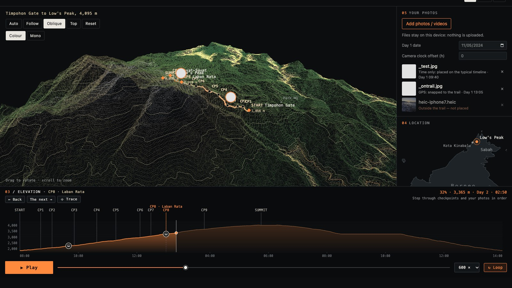
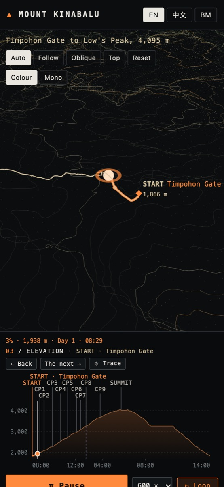

# mount-replay

**Replay the two-day Mount Kinabalu climb in 3D, from Timpohon Gate to Low's Peak (4,095 m), and drop your own photos onto the trail.**



<p align="center"></p>

Live (after the first Pages deploy): https://noowxela.github.io/mount-replay/

## Features

- **3D terrain**: Copernicus GLO-30 elevation drawn as a dot cloud with 100 m contour lines (Three.js), colour or mono, with Auto / Follow / Oblique / Top cameras.
- **Checkpoints**: START (Timpohon Gate), CP1–CP9 (the shelters, Laban Rata, Sayat-Sayat) and SUMMIT (Low's Peak). The short code goes on the map and profile, and the full name appears in tooltips, on the active checkpoint and in the chapter line.
- **Typical 2-day timeline**: 08:00 start, overnight at Laban Rata (with a night card), 02:30 summit push, sunrise on top, then the descent. It is clearly labelled TYPICAL because it is not a recording.
- **Elevation panel**: time-axis profile with an orange gradient fill, a gridline every 100 m, checkpoint labels, photo/video markers that cluster instead of overlapping, Back / The next / Trace, play/pause, a slider, speed and loop controls.
- **Your photos and videos**: EXIF GPS and capture time via exifr (JPEG, PNG, WebP, **HEIC/HEIF**); QuickTime/MP4 creation time and ISO 6709 location for videos. HEIC is converted to JPEG in the browser for display.
- **Trail filter**: files with GPS are placed only within **300 m** of the trail. Others show as "Outside the trail — not placed".
- **Kept on this device**: imported files, their thumbnails and metadata are saved in IndexedDB, so they survive a reload. **Clear my photos** removes them. If storage is full, you are told which photos won't be kept.
- **Batched import**: 20 files at a time, with metadata and thumbnails in parallel and HEIC decoded in a Web Worker pool. Each file gets a status row, with "Processing n of N" overall.
- **Languages**: English, 中文, Bahasa Melayu.
- Respects `prefers-reduced-motion`; responsive down to 390 px.

## How it works

**Data pipeline** (`scripts/bake.py`, run once offline; output committed in `public/data/`):
1. Mosaic two Copernicus GLO-30 tiles (N05/N06 E116) and resample them bilinearly to a 721×721 grid (~30.6 m) over 22×22 km → `terrain.bin` (int16) + `terrain.json`.
2. Pull the summit trail ways, shelters, peaks and km posts from OpenStreetMap (Overpass), chain the ways into one line, sample DEM heights along it and snap the checkpoints to it → `trail.json`.
3. Clip the Natural Earth 1:10m land polygons around Borneo for the location inset → `inset.json`.

**Placement rules** for uploaded files (`src/main.ts`, `placeMedia`):
- **Has GPS**: if it is within `TRAIL_RADIUS_M = 300` m of the OSM trail line, it snaps to the nearest trail point. Its time is the capture time if that falls inside the climb, otherwise the typical time at that point. **If it is further away, it is not placed at all**, whatever its time.
- **No GPS, has a capture time**: it is matched by **time of day** against the typical two-day schedule, not by a fixed date. Day 1 is anchored to your photos automatically: the photo date (or the day before) that puts the most photos inside the climb wins. You can override it with the "Day 1 date" field, and fix the camera clock with "camera clock offset". Times up to 90 min before the start or after the finish snap to the start or finish. Anything else is "No location; time outside the climb — not placed".
- **iPhone**: Safari's photo picker strips location unless you tap **Options → Location** when choosing photos. When photos arrive without GPS, the app shows a hint saying so.
- Excluded files never touch the chart, map or time axis. The axis always covers just the climb.

## Data sources and attribution

- **Terrain**: Copernicus GLO-30 DEM. © DLR e.V. 2010-2014 and © Airbus Defence and Space GmbH 2014-2018 provided under COPERNICUS by the European Union and ESA; all rights reserved. Fetched from the AWS Open Data `copernicus-dem-30m` bucket. Heights are exaggerated 1.6× in the view.
- **Trail, checkpoints, peaks, km posts**: © OpenStreetMap contributors, available under the Open Database License (ODbL): https://www.openstreetmap.org/copyright
- **Borneo outline**: Natural Earth (public domain).
- **Cited heights and walking times**: Timpohon Gate 1,866 m, Laban Rata 3,270 m, Low's Peak 4,095 m, and walking times (Timpohon → Laban Rata 3–6 h, Laban Rata → Low's Peak 2–4 h) come from Wikipedia, "Mount Kinabalu" (fetched 2026-10-14). Shelter heights are from OSM `ele` tags. The ~8.7 km trail length is the figure on the park's trail signposts.
- **Test fixture**: `scripts/fixtures/heic-iphone7.heic` is from the [exifr](https://github.com/MikeKovarik/exifr) test fixtures (MIT).
- **Libraries**: three.js (MIT), exifr (MIT), libheif-js (LGPL-3.0, loaded as a separate worker chunk), heic2any (MIT, fallback).
- **Inspiration**: the presentation ideas (elevation strip with media markers, transport bar, panel numbering) came from the Hakkoda replay demo, https://demo.pa-to-po.com/demos/hakkoda-replay/. Only ideas were taken; no code or assets were copied.

## Known data gaps

- The OSM trail measures **8.0 km**; the signposts say about **8.7 km**, so the drawn line is a little simplified.
- The DEM is a 30 m surface model, so the summit reads ~4,017–4,056 m on the grid rather than **4,095 m**. Labels use the cited heights.
- **Laban Rata** is cited at **3,270 m**; OSM tags it 3,238 m and the DEM gives ~3,263 m.
- The timeline is typical, not a recorded track. There is no GPX import yet.

## Development

Requires Node 20+ (developed on Node 22) and Google Chrome for the smoke check.

```sh
npm i
npm run dev            # Vite dev server (default http://localhost:5173; use --port to change)
npm run typecheck
npm run i18n           # EN / zh / ms key parity
npm run build          # typecheck + production build into dist/
npx vite preview --port 4173 --host 127.0.0.1 &
npm run smoke -- http://127.0.0.1:4173/ shots          # Playwright smoke check + screenshots
npm run smoke:base     # same check on a production build served under /mount-replay/ (as on GitHub Pages)
node scripts/bench-import.mjs http://127.0.0.1:4173/ 20  # import timing for 20 HEIC photos
```

The smoke check covers desktop and mobile, the three languages, the night card, the cameras, EXIF placement, the trail filter, HEIC decoding and its loading state, batched import order, marker overlap and the 100 m ticks. It fails on any console error. Set `CHROME_PATH` if Chrome is not in `/Applications`.

To rebuild the data, run `scripts/bake.py` (Python with numpy and tifffile) with the two GLO-30 tiles, an Overpass JSON and the Natural Earth land file in the working directory. These raw inputs are git-ignored.

## Project structure

```
index.html              page shell and panels
src/main.ts             state, replay loop, labels, transport, media placement
src/data.ts             data loading, typical itinerary, trail helpers
src/terrain.ts          Three.js dot/contour terrain and cameras
src/chart.ts            elevation panel (SVG)
src/store.ts            IndexedDB persistence (local only)
src/media.ts            file import: EXIF / QuickTime metadata, HEIC, thumbnails, batching
src/heic.worker.ts      HEIC → JPEG worker (libheif WASM + OffscreenCanvas)
src/inset.ts            Borneo location inset
src/i18n.ts             EN / 中文 / BM strings
src/styles.css          styles
public/data/            baked terrain, trail and inset data
scripts/bake.py         data pipeline
scripts/smoke.mjs       Playwright smoke check
scripts/bench-import.mjs  import benchmark
scripts/i18n-check.mjs  translation key check
docs/screenshots/       README images
.github/workflows/deploy.yml  GitHub Pages deploy
```

## Privacy

Your photos and videos never leave your device. They are read in the browser with the File API, and metadata, HEIC conversion and thumbnails all happen locally. Nothing is uploaded and there is no analytics. To survive a reload, the original files, thumbnails and parsed metadata are stored in this browser's IndexedDB (origin-local; not synced anywhere). **Clear my photos**, or clearing site data, deletes them.

## Licence

The code is released under the [MIT License](LICENSE), © 2026 Alex Woon.

The data keeps its own licences: OpenStreetMap data under the ODbL (© OpenStreetMap contributors), the Copernicus GLO-30 DEM under the Copernicus licence terms (attribution above), and Natural Earth in the public domain. libheif-js, loaded as a separate worker chunk, is LGPL-3.0.
